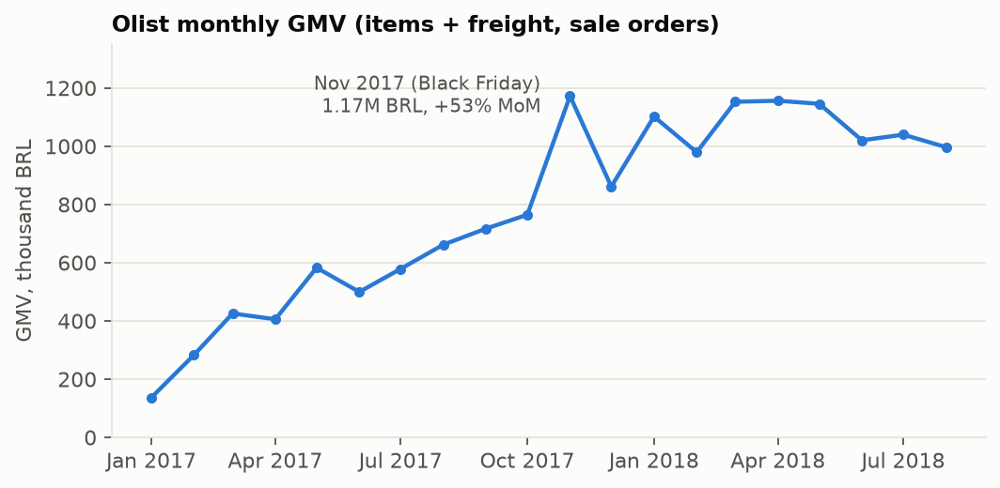
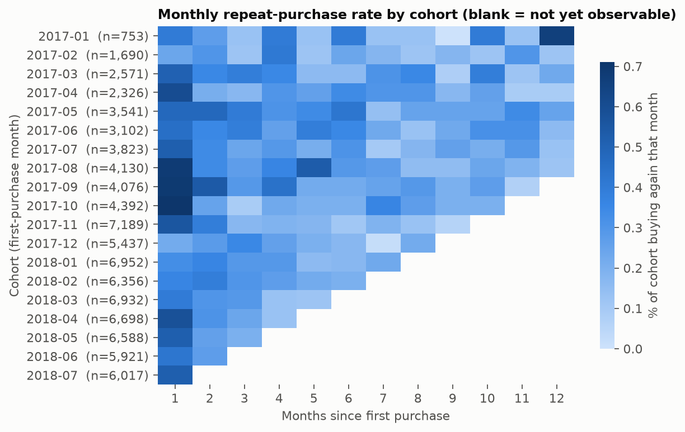
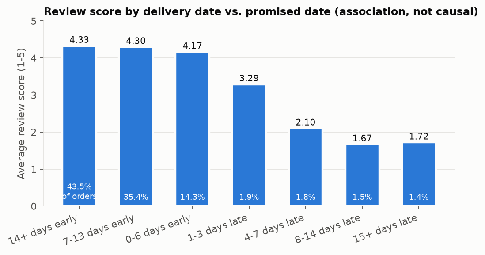
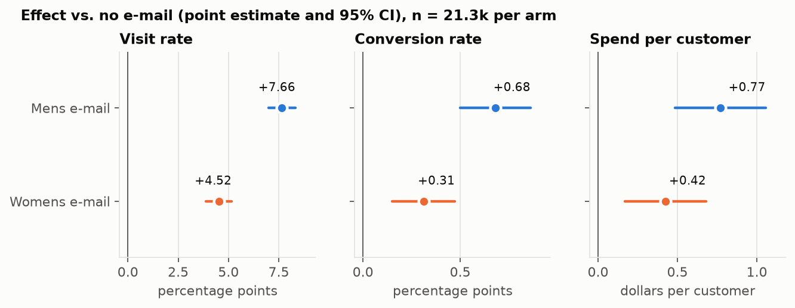
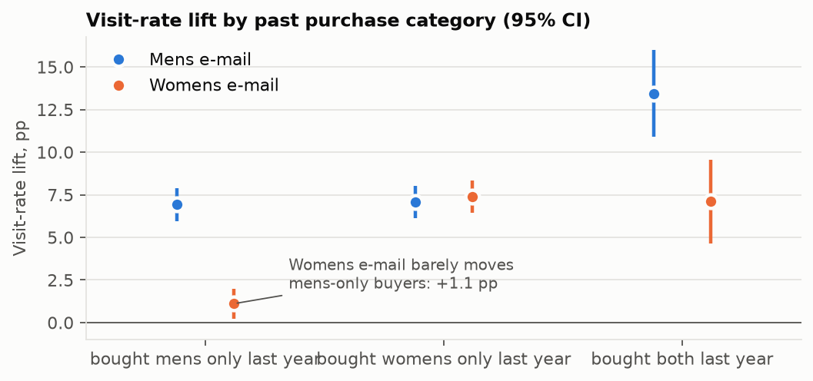
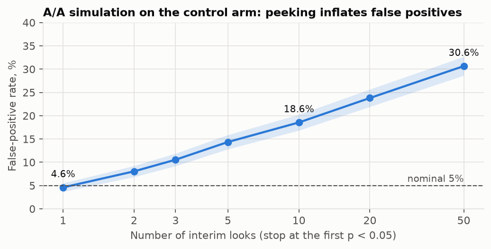

# SQL product analytics and A/B test analysis on public data

Two small, reproducible analyses that use the same toolkit as product data science
day to day: SQL against a relational warehouse (DuckDB) for product and marketplace
questions, and a full readout of a randomised experiment.

1. **SQL analytics on Olist** – nine tables of real (anonymised) Brazilian e-commerce
   orders, 2016–2018, plus Olist's seller-acquisition funnel. Eight queries, each
   answering one business question: fulfilment funnel, GMV growth, cohort retention,
   repeat purchase, delivery delay vs. review score, top categories per state, seller
   concentration, and lead-to-seller conversion.
2. **E-mail A/B test (Hillstrom, 2008)** – 64,000 customers randomised into three arms
   (Mens e-mail, Womens e-mail, no e-mail). Sample-ratio and balance checks,
   minimum detectable effects, z- and Welch tests with confidence intervals,
   Holm-adjusted families, CUPED and regression adjustment, a non-inferiority
   guardrail, a heterogeneity test, and an A/A simulation of peeking.

Author: Xi Chen (October 2026).

## Results at a glance

| | Result |
|---|---|
| Fulfilment funnel (orders Jan 2017 – Jul 2018) | 97.1% of 92,580 orders delivered; the largest loss is approval → carrier hand-off (1,533 orders, 1.7%) |
| GMV | 137k BRL in Jan 2017 → 0.98–1.16M BRL per month in 2018; Nov 2017 (Black Friday) peak, +53% MoM; YoY growth slowed from +171% (Mar 2018) to +51% (Aug 2018) |
| Retention | 97.0% of 94,703 customers bought once; 180-day repeat rate (on a later day) 1.98%; monthly cohort retention 0–0.7% |
| Delivery vs. reviews | 6.6% of orders arrive late; their average score falls from 4.2–4.3 to 1.7–3.3 and the 1-star share from about 7% to 25–71% |
| Seller concentration | 4.2% of 3,029 sellers make half of item revenue; the top decile makes 67% |
| A/B: sample ratio | 21,306 / 21,307 / 21,387 per arm, χ² p = 0.90 (no SRM); max \|SMD\| on 11 pre-treatment covariates = 0.014 |
| A/B: primary metric (visit) | control 10.6%; Mens e-mail **+7.7 pp** (95% CI 7.0–8.3), Womens e-mail **+4.5 pp** (3.9–5.2); Holm p < 1e-40 |
| A/B: revenue per recipient | control $0.65; Mens **+$0.77** (0.49–1.05), Womens **+$0.42** (0.17–0.68); bootstrap CIs agree; guardrail passes |
| A/B: head to head | Mens beats Womens on visit (+3.1 pp, 2.4–3.8), conversion (+0.37 pp, 0.17–0.56) and spend (+$0.35, 0.03–0.66; Holm p = 0.03) |
| A/B: heterogeneity | Womens e-mail lifts visits by 7.4 pp among past womens-only buyers but 1.1 pp among mens-only buyers (difference 6.3 pp, 5.0–7.6); the Mens e-mail works equally for both |
| A/B: sensitivity | MDE 0.92 pp (8.7% relative) for visit, but 43% relative for conversion; a +10% conversion lift would need 387k customers per arm |
| A/B: CUPED | past-year spend correlates only 0.02–0.07 with the outcomes, so variance falls by < 0.5% – reported as a null result |
| Peeking (A/A simulation) | false-positive rate 4.6% with one look, 18.6% with 10 looks, 30.6% with 50 looks |

---

## Part 1 – SQL analytics on Olist

**Data model.** `orders` (one row per order) joins `customers` on `customer_id`,
`order_items` (one row per item, with `product_id` and `seller_id`), `payments`,
`reviews`, `products` (with an English category table) and `sellers`. The funnel
tables `mqls` (marketing-qualified leads) and `closed_deals` join to sellers on
`seller_id`. One trap shapes every customer-level query: `customer_id` is issued
per order; the person is `customer_unique_id`.

**Cleaning lives in one place** – [`sql/olist/01_views.sql`](sql/olist/01_views.sql):
`order_facts` (one row per order with value, timestamps and the person key; a *sale*
is an order with items that was not canceled or unavailable), `order_reviews` (one
review per order; 547 orders have several), `products_en`, and `analysis_window`
(Jan 2017 – Aug 2018: earlier months have a few hundred orders with whole months
missing, later months have almost none – see `q02`).

**Data checks** – [`sql/olist/02_checks.sql`](sql/olist/02_checks.sql) – found no
duplicate or orphaned keys, but 775 orders without items, 249 orders whose payments
differ from items + freight by more than 1 BRL (vouchers and instalment interest), 14
orders whose status and delivery timestamp disagree, and 2,997 people with more than
one `customer_id`. Each is handled by a definition in the views or queries.

| Query | Business question | SQL techniques |
|---|---|---|
| [q01](sql/olist/q01_fulfilment_funnel.sql) | Where are orders lost between approval, shipping and delivery? | chained CTEs, monotone stage flags, `COUNT(*) FILTER`, `FIRST_VALUE` / `LAG` |
| [q02](sql/olist/q02_monthly_gmv.sql) | How did monthly GMV grow, MoM and YoY? | `DATE_TRUNC`, `LAG`, self-join for YoY (safe when months are missing), moving average and running total with `ROWS` frames |
| [q03](sql/olist/q03_cohort_retention.sql) | What share of each first-purchase cohort buys again k months later? | `MIN() OVER (PARTITION BY)`, month differences, cohort × month grid with `range()`, right-censored cells left NULL |
| [q04](sql/olist/q04_repeat_purchase.sql) | How many customers come back, and when? | per-person window, `MIN … FILTER`, fair 180-day eligibility window, medians with `QUANTILE_CONT` |
| [q05](sql/olist/q05_delivery_vs_review.sql) | How does delivery timing relate to review scores? | join to a de-duplicated view, `CASE` bucketing, rates as `AVG(CASE …)`, share of total with `SUM() OVER ()` |
| [q06](sql/olist/q06_top_categories_by_state.sql) | Top three categories by revenue in the five largest states | four-table join, semi-join with `IN`, `ROW_NUMBER() OVER (PARTITION BY)` + `QUALIFY` |
| [q07](sql/olist/q07_seller_concentration.sql) | How concentrated is revenue among sellers? | running share with `SUM() OVER (ORDER BY …)`, `NTILE`, first row crossing a threshold |
| [q08](sql/olist/q08_lead_funnel.sql) | Which lead sources turn into active sellers? | `LEFT JOIN` that keeps unconverted leads, `EXISTS`, 90-day activation with a full-window rule |

### Findings

- **Fulfilment.** Of 92,580 orders placed Jan 2017 – Jul 2018 (August excluded so
  that orders in transit are not counted as lost), 99.93% were approved, 98.27%
  handed to a carrier and 97.05% delivered.
- **Growth.** GMV rose from 137k BRL in January 2017 to 0.98–1.16M BRL a month in
  2018. Growth flattened in 2018: YoY growth fell from +171% in March to +51% in
  August, and MoM growth stayed between −11% and +18% from February to August 2018.

  

- **Retention is close to zero.** 96.97% of customers placed one order; only 2.17%
  bought on more than one day. Among customers with a full 180-day follow-up
  (n = 57,283), 1.98% returned within 180 days; the median gap to the second
  purchase was 74 days (IQR 23–174). Repeats are counted by day, not by order:
  28.6% of customers with several orders placed them all on one day (split baskets). For a marketplace like this, monthly cohort retention is not a
  useful north-star metric; acquisition and first-order experience matter more.

  

- **Late delivery goes with bad reviews.** 93.2% of delivered orders arrive on or
  before the promised date (43.5% at least two weeks early – the promise is padded).
  The 6.6% that arrive late average 1.7–3.3 stars against 4.2–4.3, and 25–71% of
  them get 1 star. This is an association: late orders differ in region, product
  size and seller, so it does not show how much faster delivery would raise scores.

  

- **Categories and sellers.** Revenue is spread across categories (the top three
  take 23–27% of each large state's revenue: bed_bath_table, health_beauty and
  watches_gifts lead in São Paulo) but concentrated across sellers: 128 of 3,029
  sellers (4.2%) make half of item revenue, and the bottom half of sellers makes 3.3%.
- **Seller acquisition.** 842 of 8,000 leads (10.5%) closed. Paid search and organic
  search close at about 12%, social at 5.6% and e-mail at 3.0%. Among deals with a
  full 90-day window, 55% of paid-search sellers made a sale within 90 days against
  39% for organic search. Sources attract different sellers, so these are
  descriptive differences, and the smaller sources rest on 6–55 deals.

---

## Part 2 – E-mail A/B test (Hillstrom)

**Design.** 64,000 customers who bought in the last 12 months were randomised into
three equal arms; visits, conversions and spend were tracked for two weeks after
the e-mail. All design choices were fixed in [`src/config.py`](src/config.py) before
any outcome column was analysed:

| | Choice |
|---|---|
| Unit of randomisation and analysis | customer |
| Primary metric | visit within 2 weeks (0/1) |
| Secondary metrics | conversion (0/1), spend per customer (zeros kept = revenue per recipient) |
| Guardrail | spend per customer may not fall by more than 10% of the control mean (one-sided non-inferiority, α = 0.025) |
| Families for multiple comparisons | primary: 2 tests (each e-mail vs. none); secondary: 4 tests; head to head: 3 tests – Holm within each family |
| Tests | two-proportion z-test (pooled SE for the test, unpooled for the CI); Welch t-test for spend, checked with a 2,000-replicate bootstrap |
| SRM alarm | χ² goodness of fit against 1/3 : 1/3 : 1/3, alarm at p < 0.001 |

Arm-level sufficient statistics (n, mean, variance) come from SQL
([`sql/experiment/`](sql/experiment)); the tests are computed from them in Python
([`src/abstats.py`](src/abstats.py)), the same split an experimentation platform uses.
Every formula in `abstats.py` is written out and checked against SciPy / statsmodels
in [`src/00_selfcheck.py`](src/00_selfcheck.py), together with a CI-coverage simulation.

**Validity checks.** No NULLs, no conversion without a visit, no spend without a
conversion. Arm sizes 21,306 / 21,307 / 21,387 (χ² = 0.20, p = 0.90: no SRM).
Standardized mean differences on all 11 pre-treatment covariates are below 0.014
in absolute value.

**Sensitivity (before reading effects).** With 21.3k customers per arm, 80% power and
Bonferroni α per test, the experiment can detect a visit lift of 0.92 pp (8.7%
relative to the 10.6% baseline), but only a 0.24 pp conversion lift (43% relative)
and a $0.37 spend lift (57% relative). A realistic +10% lift would need 16k customers
per arm for visits, 387k for conversion and 703k for spend. The baseline is the
control arm, standing in for pre-experiment history this dataset does not have.

### Effects vs. no e-mail

| Metric | Control | Mens e-mail | Womens e-mail |
|---|---|---|---|
| Visit rate | 10.62% | 18.28%: **+7.66 pp** (7.00–8.32), +72% | 15.14%: **+4.52 pp** (3.89–5.16), +43% |
| Conversion | 0.573% | 1.253%: **+0.68 pp** (0.50–0.86), +119% | 0.884%: **+0.31 pp** (0.15–0.47), +54% |
| Spend per customer | $0.653 | $1.423: **+$0.77** (0.49–1.05) | $1.077: **+$0.42** (0.17–0.68) |

95% CIs in brackets; Holm-adjusted p-values are below 0.0012 for all six tests.
Bootstrap CIs for spend: 0.48–1.05 and 0.16–0.68, matching Welch's.



**Guardrail.** The margin is −$0.065 per customer. The lower 95% bounds of the spend
difference are +$0.49 (Mens) and +$0.17 (Womens), so both e-mails pass.

**Head to head.** The Mens e-mail beats the Womens e-mail on visits (+3.14 pp,
2.43–3.84), conversion (+0.37 pp, 0.17–0.56) and spend (+$0.35, 0.03–0.66; Holm
p = 0.03; the spend difference is the least certain).

**Heterogeneity (one pre-specified contrast per e-mail).** Does each e-mail lift
visits more among customers who bought that category last year?

- Womens e-mail: +7.40 pp among womens-only buyers vs. +1.11 pp among mens-only
  buyers – a difference of 6.29 pp (5.00–7.58, Holm p = 2e-21).
- Mens e-mail: +6.92 pp vs. +7.06 pp – no difference (−0.14 pp, −1.49 to 1.21, p = 0.84).
- Customers who bought both categories respond most (Mens +13.4 pp, Womens +7.1 pp).

The contrast was written into the code before the first run, but this dataset has
been analysed widely, so it is not a true pre-registration.



**Variance reduction.** CUPED on past-year spend and a regression adjustment on five
pre-treatment covariates (Lin 2013: centred covariates interacted with treatment,
HC2 standard errors) give the same estimates but shrink standard errors by only
0.0–1.3%. CUPED removes a share ρ² of the variance, and past-year spend correlates
only 0.02–0.07 with two-week outcomes. CUPED pays off when the covariate is the same
metric measured before the experiment (for example, visits in the previous month),
which this dataset does not record.

**Decision.** Both e-mails beat sending nothing on every metric, and the guardrail
holds. If one campaign goes to everyone, send the Mens e-mail: it wins on all three
metrics overall; on visits it is ahead among mens-only buyers and buyers of both
categories, and within 0.4 pp of the Womens e-mail among womens-only buyers. The
Womens e-mail is close to useless for mens-only buyers. Caveats: two-week outcomes
only, and unsubscribes are not observed (see Limitations).

### Pitfalls this analysis guards against

- **Peeking.** Checking a running test and stopping at the first p < 0.05 inflates
  false positives. An A/A simulation on the control arm (2,000 random splits in a
  random arrival order) gives 4.6% ± 0.5% with one look, 18.6% with 10 looks and
  30.6% with 50. Splitting α across 10 looks (Bonferroni) brings it back to about 2% –
  safe but conservative; group-sequential boundaries (O'Brien–Fleming) or
  always-valid sequential tests are the efficient fixes.

  

- **Multiple comparisons.** Two treatment arms × three metrics plus subgroups is
  more than ten tests. Each family is Holm-adjusted; the six subgroup lifts are
  reported with Benjamini–Hochberg q-values and treated as exploratory.
- **Sample ratio mismatch.** Checked before anything else; an SRM would mean broken
  assignment or logging, and no effect estimate would be trusted.
- **Novelty effects.** They cannot be tested here: there is a single two-week window
  and no daily data. A durable effect would need a long-running holdout group and
  the lift tracked by week since first exposure.
- **Conditioning on a post-treatment variable.** Average order value among converters
  is not a causal comparison (the e-mail changes who converts), so spend is analysed
  per recipient, zeros included.
- **Intention to treat.** Opens are not observed, so effects are per e-mail *sent*,
  which is the quantity a send decision needs.

---

## How to run

```bash
conda env create -f environment.yml
conda activate sqlab
bash run_all.sh            # a minute or two; logs in logs/
```

`run_all.sh` runs, in order: `00_selfcheck` (statistics vs. SciPy / statsmodels),
`01_get_data` (downloads about 49 MB and records SHA-256 hashes), `02_build_db`
(loads `data/warehouse.duckdb` and creates the views), `03_run_sql`,
`04_experiment` and `05_figures`. Every number in this README is in `results/`;
random steps use a fixed seed (`src/config.py`).

## Data sources and licenses

| Dataset | Source | License | In this repo |
|---|---|---|---|
| Brazilian E-Commerce Public Dataset by Olist | [Kaggle: olistbr/brazilian-ecommerce](https://www.kaggle.com/datasets/olistbr/brazilian-ecommerce) | CC BY-NC-SA 4.0 | not included; downloaded by `01_get_data.py` |
| Marketing Funnel by Olist | [Kaggle: olistbr/marketing-funnel-olist](https://www.kaggle.com/datasets/olistbr/marketing-funnel-olist) | CC BY-NC-SA 4.0 | not included |
| MineThatData E-Mail Analytics Challenge (K. Hillstrom, 2008) | [MineThatData blog, March 2008](https://blog.minethatdata.com/2008/03/minethatdata-e-mail-analytics-and-data.html) | none stated | not included |

Code is released under the MIT License (`LICENSE`). Aggregated results derived from
the Olist data (`results/olist/`, figures 01–03) are shared under CC BY-NC-SA 4.0
with attribution to Olist.

## Limitations

- **Hillstrom** is a single 2008 campaign with two-week outcomes. Unsubscribes and
  complaints, the natural e-mail guardrails, are not recorded, so spend per
  recipient stands in as the guardrail. The power analysis uses the control arm as
  its baseline because no pre-experiment data exist.
- **Olist** is anonymised marketplace data from 2016–2018. All Part 1 results are
  descriptive; none of the comparisons (late vs. on-time, lead source) is causal.
  Cohort cells rest on 0–40 returning customers each, so month-to-month variation
  in the heatmap is mostly noise.
- **Engine.** SQL is DuckDB. Most of it is standard; `QUALIFY`, `FILTER`, `UNPIVOT`,
  `range()` and `QUANTILE_CONT` have close equivalents in BigQuery, Snowflake and
  Postgres.

## Layout

```
sql/olist/        01_views.sql, 02_checks.sql, q01–q08 (one business question each)
sql/experiment/   e00_checks, e01_assignment, e02_balance, e03_arm_metrics, e04_segment_visits
src/              config.py (all choices), abstats.py (statistics), 00–05 pipeline steps
results/          CSV output of every query and test, summary.json
figures/          README figures
```
